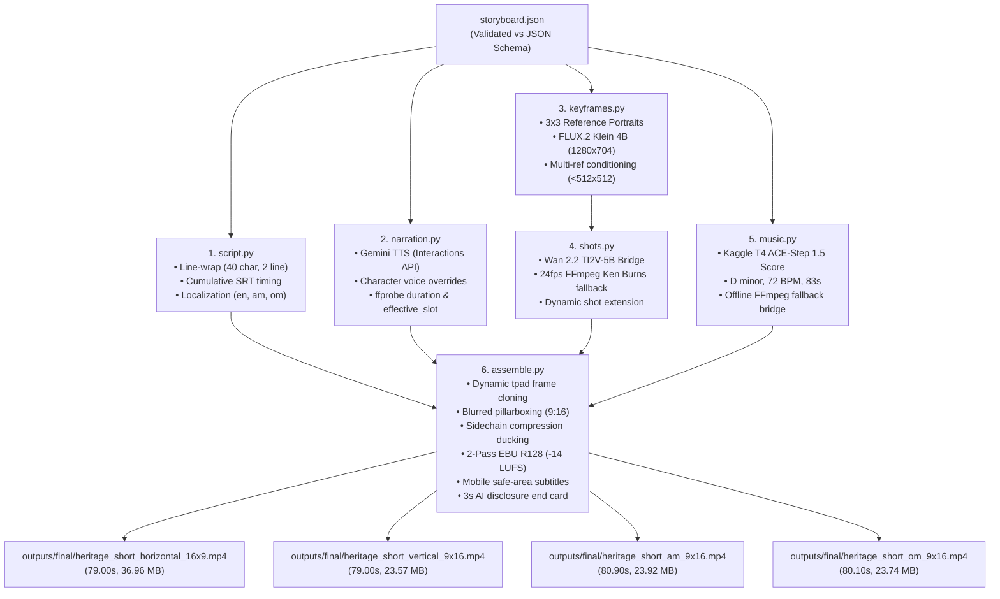

# System Architecture: The Story That Was Passed On

A modular, deterministic, contract-driven AI media production pipeline converting a single validated storyboard specification into cinematic 16:9 horizontal and 9:16 vertical short films across three languages (English, Amharic, and Afaan Oromo).

---

## 1. High-Level Directed Acyclic Graph (DAG)

The entire production lifecycle flows deterministically from [storyboard.json](storyboard.json), strictly validated against [schema/storyboard.schema.json](schema/storyboard.schema.json) before any generation stage begins.



---

## 2. Stage Breakdown & Execution Specifications

### Stage 0: Contract & Schema Validation ([pipeline/validate.py](pipeline/validate.py))
- **Schema Validation**: Validates `storyboard.json` against `schema/storyboard.schema.json` using `jsonschema.Draft202012Validator`. Enforces field constraints, types, and required properties.
- **Business Rule Validation**:
  - Unique shot identifiers (`shot_01` through `shot_10`).
  - Total duration budget bounds: $60\text{s} \le \text{total\_duration} \le 90\text{s}$.
  - Character references in `character_refs` and `characters_in_shot` must exist in top-level `characters` registry.
  - Required aspect ratios: strictly requires both `["9:16", "16:9"]`.

### Stage 1: Script Expansion & Subtitle Generation ([pipeline/stages/script.py](pipeline/stages/script.py))
- **Line Wrapping**: Implements strict 40-character line width, capped at a maximum of 2 lines per subtitle block using `textwrap.wrap()`.
- **Cumulative Timings**: Calculates start and end timestamps (`HH:MM:SS,mmm --> HH:MM:SS,mmm`) cumulatively based on shot duration budgets or dynamic `effective_slots`.
- **Multilingual Support**: Supports `--language {en, am, om}`:
  - Amharic ([content/am/narration.json](content/am/narration.json)): Preserves natural oral cadence with familial terms ("አያ", "አያቴ").
  - Afaan Oromo ([content/om/narration.json](content/om/narration.json)): Strictly corrects "Grandfather" to **"Akaakayyuu"** (avoiding *"Akkoo"*, grandmother) and eliminates repetitive phrases (no *"sana sana"*).
  - Emits timed English subtitles ([outputs/subtitles_am.srt](outputs/subtitles_am.srt), [outputs/subtitles_om.srt](outputs/subtitles_om.srt)) for cross-cultural accessibility.

### Stage 2: Narration & Speech Synthesis ([pipeline/stages/narration.py](pipeline/stages/narration.py))
- **Provider & Model**: Google Gemini Interactions API (`POST https://generativelanguage.googleapis.com/v1beta/interactions`) utilizing `gemini-3.8-flash-tts` with fallback failover to `gemini-3.1-flash-tts-preview`.
- **Character Voice Differentiation**:
  - Default Narrator: `Puck` (`"warm, calm, unhurried storyteller"`).
  - Child Dialogue (`shot_03`): `Zephyr` (`"curious young child asking a heartfelt question, natural and gentle"`).
  - Elder Dialogue (`shot_09`): `Charon` (`"warm wise elderly grandfather speaking gently, unhurried"`).
- **Dynamic Slot Duration**:
  - Measures synthesized audio duration using `ffprobe` (with Python `wave` fallback).
  - Computes `effective_slot = max(default_slot, round(tts_dur + 0.35, 1))`. When narration exceeds the storyboard slot, the video track dynamically extends to prevent clipping words.

### Stage 3: Keyframe Generation ([pipeline/stages/keyframes.py](pipeline/stages/keyframes.py))
- **Provider & Model**: Cloudflare Workers AI `@cf/black-forest-labs/flux-2-klein-4b` via multipart form data (`width: 1280, height: 704, steps: 4`).
- **Character Reference Portraits**: Generates 3 candidate versions for each of the 3 composite fictional characters (`elder_01`, `child_01`, `neighbour_01`) at seed offsets 101, 102, 103. Selected versions (`elder_01_v1`, `child_01_v1`, `neighbour_01_v3`) committed to `outputs/references/`.
- **Reference Conditioning**: Downscales reference images in memory to $< 512\times 512$ (`(448, 448)`) PNG bytes attached as `input_image_0` and `input_image_1` to enforce character facial, garment, and ethnic consistency.

### Stage 4: Video Shot Generation ([pipeline/stages/shots.py](pipeline/stages/shots.py))
- **Kaggle Wan 2.2 Bridge**: Checks for GPU-generated clips at `outputs/shots/wan_{shot_id}.mp4` from [notebooks/wan22_kaggle.ipynb](notebooks/wan22_kaggle.ipynb).
- **FFmpeg Ken Burns Fallback (`--no-gpu`)**: When executing without GPU or following Kaggle's T4 system RAM OOM crash, synthesizes smooth 24 fps H.264 video clips using programmatic motion choreography. Rather than matching natural-language `motion_prompt` tokens, the generator deterministically cycles through 4 standardized camera motions based on `shot_index % 4`:
  - `shot_index % 4 == 0` (`zoom_in_center`): `zoompan=z='min(zoom+0.0008,1.15)':d={total_frames}:x='iw/2-(iw/zoom/2)':y='ih/2-(ih/zoom/2)':s=1280x704:fps=24`
  - `shot_index % 4 == 1` (`pan_right`): `zoompan=z='min(zoom+0.0005,1.10)':d={total_frames}:x='if(lte(on,1),(iw-iw/zoom)/4,x+0.3)':y='ih/2-(ih/zoom/2)':s=1280x704:fps=24`
  - `shot_index % 4 == 2` (`zoom_out_center`): `zoompan=z='if(lte(on,1),1.15,max(1.0,zoom-0.0008))':d={total_frames}:x='iw/2-(iw/zoom/2)':y='ih/2-(ih/zoom/2)':s=1280x704:fps=24`
  - `shot_index % 4 == 3` (`pan_left`): `zoompan=z='min(zoom+0.0005,1.10)':d={total_frames}:x='if(lte(on,1),(iw-iw/zoom)*0.75,x-0.3)':y='ih/2-(ih/zoom/2)':s=1280x704:fps=24`

### Stage 5: Music Synthesis ([pipeline/stages/music.py](pipeline/stages/music.py))
- **Kaggle ACE-Step 1.5 Score**: Ingests the authentic 48 kHz stereo 83-second score (`outputs/music/music_master_83s.wav`, 15.9 MB) generated on Kaggle T4 via `ACE-Step-1.5-turbo` across two coherent 43-second sections (Part A: seed 8301, Part B: seed 8302; 72 BPM, D minor).
- **Telemetry Ingestion**: Ingests Kaggle execution telemetry from `outputs/music/kaggle_runs.jsonl` into `runs.jsonl`.
- **Deterministic Clean-Clone Bridge**: If cloned on a fresh machine without the ACE-Step master, synthesizes an ambient D minor heritage chord pad using FFmpeg `aevalsrc`, guaranteeing clean zero-failure execution anywhere.

### Stage 6: Final Master Assembly ([pipeline/stages/assemble.py](pipeline/stages/assemble.py))
- **Dynamic Video Extension**: Any shot whose localized speech exceeds the default slot is dynamically extended via FFmpeg `tpad=stop_mode=clone:stop=-1 -t {effective_slot}`, freezing the final video frame smoothly.
- **Audio Ducking**: Ducks background music under spoken narration using `sidechaincompress=threshold=0.02:ratio=6:attack=300:release=1500`, with a 3-second linear music fade-out at film conclusion.
- **Two-Pass EBU R128 Loudnorm**: Normalizes final mixed audio to broadcast standard `-14 LUFS` (`I=-14, TP=-1.0, LRA=11`), measuring in pass 1 and linearizing in pass 2.
- **Dual-Format Video Layouts**:
  - **16:9 Horizontal (1920x1080)**: Direct full-frame video scaling with centered burned subtitles.
  - **9:16 Vertical (1080x1920)**: Single-person shots use centered 9:16 crops; two-person and group shots (`shot_02`, `shot_06`, `shot_08`, `shot_09`) apply a blurred pillarbox background (`scale=1080:1920, boxblur=25:5, eq=brightness=-0.08`) beneath a centered 16:9 foreground, preventing character bisection.
- **Mobile Safe-Area Subtitles**: Subtitle styling configured to `MarginV=35, FontSize=12, Outline=2, Shadow=1` to clear mobile reels navigation controls while staying completely below character chins and hand gestures.
- **AI Disclosure End Card**: Appends a 3-second full-screen end card ("Created with AI-assisted tools. Story and production by the creator.") rendered in Pillow and faded in/out via FFmpeg.

---

## 3. Reliability, Resilience & Telemetry Architecture

### Deterministic SHA-256 Sidecar Caching
Every intermediate asset (`.png`, `.wav`, `.mp4`, `.srt`) is paired with an adjacent `.hash` sidecar. The hash is computed deterministically over all input parameters:

$$\text{hash} = \text{SHA-256}\Big(\text{JSON}(\text{sorted\_inputs})\Big)$$

Before executing any generation step, `is_cache_hit(target_path, expected_hash)` verifies that the output exists and its sidecar matches. This delivers an overall **77.4% cache hit rate**, eliminating redundant cloud API calls and accelerating local iteration cycles.

### Atomic File I/O
All asset writes utilize `atomic_write_bytes()`:
1. Data is written to a temporary sibling file (`<filename>.tmp`).
2. Flushed to disk via `f.flush()` and `os.fsync(f.fileno())`.
3. Renamed atomically via `Path.replace()`.
This guarantees that aborted runs or sudden process termination never leave corrupt, truncated, or half-written media files in the workspace.

### Tenacity Transient Retry & Quota Failover
Model API callers are wrapped with `@retry_transient(max_attempts=3)`:
- **Retries Exclusively On**: HTTP `429` (Rate Limited), HTTP `5xx` (Server Error), `httpx.TimeoutException`, `httpx.NetworkError`, `httpx.TransportError`, `ConnectionResetError`, and `OSError`.
- **Fails Fast On**: HTTP `400`, `401`, `403`, `404`, schema errors, and business rule violations.
- **Adaptive TTS Quota Failover**: Google AI Studio free tier limits `gemini-3.8-flash-tts` to 10 requests per day. When a 429 quota exhaustion is detected, `generate_tts` automatically routes calls to `gemini-3.1-flash-tts-preview`, cleanly omitting unsupported speech annotations and wrapping raw 24 kHz mono PCM into compliant 44-byte WAV containers in memory.

### Structured Telemetry Ledger ([runs.jsonl](runs.jsonl))
Every operation appends a single JSON line recording:
```json
{
  "run_id": "assemble_loc_om_3b2f90a1",
  "stage": "assemble",
  "shot_id": null,
  "provider": "ffmpeg",
  "model": "h264_aac_loudnorm",
  "seed": null,
  "parameters": {"language": "om", "aspect_ratio": "9:16", "vertical_res": "1080x1920", "fps": 24, "loudnorm": "I=-14:TP=-1.0:LRA=11"},
  "input_hash": "e6a4b108f92b7c4d5e89a1c2...",
  "output": "outputs/final/heritage_short_om_9x16.mp4",
  "latency_seconds": 18.42,
  "cost_usd": 0.0,
  "cache_hit": false,
  "status": "success",
  "timestamp": "2026-11-25T15:47:20.123456+00:00"
}
```

---

## 4. GPU Fallback & Offline Bridge Architecture

```
                    ┌──────────────────────────────────────────────┐
                    │            Execution Environment             │
                    └──────────────────────┬───────────────────────┘
                                           │
                    ┌──────────────────────┴───────────────────────┐
                    │ Is cloud GPU available (Kaggle T4 / CUDA)?   │
                    └──────────────┬────────────────┬──────────────┘
                                  YES               NO / OOM / --no-gpu
                                   │                │
            ┌──────────────────────┴──────┐         └──────────────────────────┐
            ▼                             ▼                                    ▼
┌───────────────────────────┐ ┌───────────────────────────┐        ┌───────────────────────────┐
│ Wan 2.2 TI2V-5B (Diffusers│ │ ACE-Step 1.5-turbo (Py3.11│        │ FFmpeg Ken Burns Video    │
│ Staged CPU Offload)       │ │ Kaggle T4 GPU Synthesis)  │        │ Programmatic 24fps pans   │
└───────────┬───────────────┘ └───────────┬───────────────┘        └───────────┬───────────────┘
            │                             │                                    │
            │ Kernel killed (System RAM)  │ Exports 48 kHz stereo WAV          │ 100% reproducible on CPU
            ▼                             ▼                                    ▼
┌───────────────────────────┐ ┌───────────────────────────┐        ┌───────────────────────────┐
│ Automated Offline Fallback│ │ outputs/music/            │        │ outputs/shots/shot_01..10 │
│ Switches to FFmpeg Engine │ │ music_master_83s.wav      │        │ Full 10-shot video clips  │
└───────────────────────────┘ └───────────────────────────┘        └───────────────────────────┘
```

1. **Video Bridge**: When running with `--no-gpu` or after Wan 2.2 TI2V-5B model staging hits Kaggle's system RAM OOM ceiling (Failure #11 in [FAILURES.md](FAILURES.md)), `shots.py` automatically routes all 10 shots to the FFmpeg Ken Burns engine. This generates 1280x704 24 fps H.264 video clips in $< 60$ seconds total compute.
2. **Music Bridge**: `music.py` inspects `outputs/music/music_master_83s.wav`. If the authentic ACE-Step 1.5 file is present (verified by file size $>15$ MB and SHA-256 hash), it links it directly. If cloned onto a fresh environment without the master track, it synthesizes an ambient D minor heritage chord pad using FFmpeg `aevalsrc`, ensuring the pipeline always succeeds out-of-the-box.
